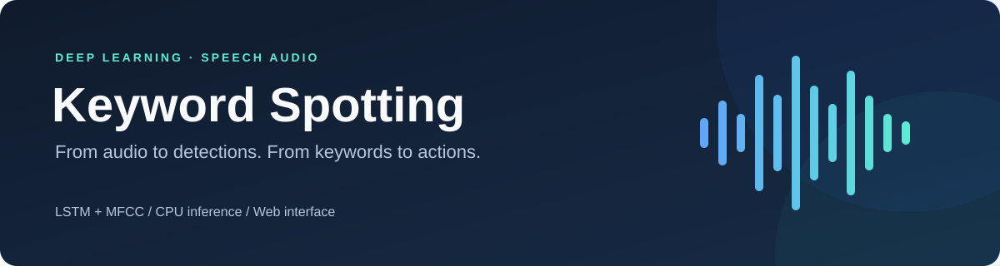
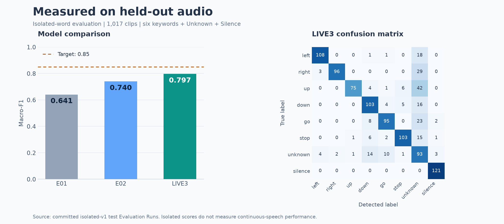

<p align="center">
  <strong>Detect spoken keywords. Explore audio. Control an interactive demo with your voice.</strong>
</p>

<p align="center">
  
  
  
  
  
</p>

<p align="center">
  <a href="#features">Features</a> ·
  <a href="#results">Results</a> ·
  <a href="#getting-started">Quick Start</a> ·
  <a href="#using-the-app">Usage</a>
</p>

## Overview

Keyword Spotting is a deep learning project that recognizes six spoken words:
**left**, **right**, **up**, **down**, **go**, and **stop**.

It combines MFCC audio features with an LSTM classifier and a web app for exploring
recordings, trying live voice interactions, and comparing model performance.
**Unknown** and **Silence** classes help reject audio outside the keyword vocabulary.

## Features

- **Audio analysis** — Upload WAV recordings and explore detections with timestamps, waveform regions, and playback.
- **Live voice control** — Use microphone input to navigate slides, adjust volume, and play or pause the in-app demo.
- **Evaluation dashboard** — Compare models using training curves, confusion matrices, per-class metrics, and CPU measurements.
- **CPU inference** — Run the local model without a GPU.
- **Optional Windows integration** — Try volume, PowerPoint slideshow, and media controls with explicit permission per session.
- **Deployment support** — Use ONNX for deployed inference and run live microphone scoring in the browser.

## How it works

```text
Audio → 16 kHz mono → MFCC features → LSTM classifier → Keyword detections
```

The local FastAPI service handles inference, recording jobs, and live audio over
WebSocket. The Next.js interface provides the analysis workspace, live demo, and
evaluation dashboard. SQLite stores local recording metadata and results.

## Results



All three models below were evaluated on the same **1,017 isolated test clips**.

| Model | Test accuracy | Test macro-F1 |
| :--- | ---: | ---: |
| E01 | 0.644 | 0.641 |
| E02 | 0.734 | 0.740 |
| **LIVE3 — local app model** | **0.781** | **0.797** |

The isolated macro-F1 target is **0.85**, which remains unmet. Continuous speech
is more challenging: E02 achieved event-F1 **0.010**, and the experimental temporal
prototype achieved **0.057** against a **0.70** target. Continuous spotting and
external voice actions remain experimental.

## Tech stack

| Layer | Technologies |
| :--- | :--- |
| Machine learning | PyTorch, LSTM, MFCC, NumPy, SciPy |
| Backend | Python 3.13, FastAPI, WebSocket, SQLite |
| Frontend | Next.js 16, React 19, TypeScript |
| Deployment inference | ONNX Runtime, ONNX Runtime Web |
| Tooling | uv, Ruff, mypy, pytest, ESLint |

## Getting started

### Prerequisites

- **Node.js 22.13.0+**
- **[uv](https://docs.astral.sh/uv/getting-started/installation/)**
- **Python 3.13**, installable with the command below
- **Windows 10/11** if you want to use the optional Windows controls

### 1. Clone and install

Run in PowerShell:

```powershell
git clone https://github.com/SumitPatel-HQ/DL.git
cd DL

uv python install 3.13
npm run setup
```

Setup installs the locked backend environment and frontend dependencies. The first
installation requires internet access; virtual environment activation is automatic.

> **Local model required:** Analysis and live inference expect
> `artifacts/models/live3/model.pt` and `artifacts/models/live3/detector.json`.
> These local artifacts are not included in Git. The app reports model
> unavailability when they are missing.

### 2. Start the backend

```powershell
npm run api
```

### 3. Start the frontend

Open a second terminal in the repository root:

```powershell
npm run web
```

Visit **[localhost:3000](http://localhost:3000)**.

## Using the app

1. **Analyze:** Open `/analyze`, upload a PCM WAV recording, select keywords, and inspect the detections.
2. **Try live input:** Open `/live`, start listening, grant microphone access, and speak one of the six keywords.
3. **Explore results:** Open `/dashboard` to inspect or import the saved Evaluation Runs.

Live actions apply to the in-app demo by default. Windows controls require a
separate opt-in and one selected target.

## Project structure

```text
├── backend/
│   ├── app/          # API, recording jobs, storage, and live sessions
│   ├── ml/           # Data pipelines, features, models, and evaluation
│   └── tests/        # Backend tests
├── frontend/
│   ├── app/          # Next.js pages
│   ├── components/   # Analysis, live, and dashboard UI
│   └── lib/          # API clients and browser audio processing
├── scripts/          # Development, reproduction, and export utilities
├── data/             # Local datasets and cached features (ignored)
└── artifacts/        # Local models and generated artifacts
```

## Development

Run linting, type checks, and tests:

```powershell
npm run check
```

Build the frontend:

```powershell
npm run build --prefix frontend
```

Reproduce the E02 evaluations after preparing the local data and checkpoint:

```powershell
uv run --project backend python scripts/reproduce.py
```
